# Sistema de Legajos de Personal

## Descripción

Sistema web del área de Legajos de la Oficina de Personal. Registra a los trabajadores con sus vínculos laborales y digitaliza su legajo personal en 12 secciones.

Incluye subida por partes y carga masiva de PDFs, descarga del legajo en ZIP, acceso restringido a documentos disciplinarios y médicos, auditoría de cada acción y copias de seguridad automáticas.

## Stack

| Capa | Tecnología | Uso |
|---|---|---|
| Frontend | Angular 22 (SPA, componentes standalone, OnPush, signals) | Cada componente en tres archivos: `.ts`, `.html` (`templateUrl`) y `.css` (`styleUrl`) |
| Estilos | CSS por componente + `styles.css` global | Variables CSS para colores y espaciado |
| Formularios | Reactive Forms | Validación tipada |
| Animaciones | Motion (`motion`, API `animate`) + `animate.enter` / `animate.leave` de Angular | Transiciones de pantallas, modales, listas y estados |
| Visor de PDF | pdf.js (`pdfjs-dist`) | Vista en el navegador con carga progresiva por rangos |
| Subida de archivos | tus (`tus-js-client` y `@tus/server`) | Subida por partes y reanudable |
| API | NestJS 11 sobre Node 22 | REST, sesiones, subidas tus, ZIP en streaming, eventos SSE |
| Worker | NestJS 11 (mismo código, otro proceso) | Procesa PDFs, carga masiva, limpieza y backup |
| ORM | Prisma 7 | Esquema y migraciones; los índices especiales y triggers van en SQL dentro de las migraciones |
| Base de datos | PostgreSQL 17 con `pg_trgm` y `unaccent` | Datos y metadatos; los PDF van en disco |
| Colas, sesiones y eventos | Redis 7 + BullMQ | Colas de trabajo, sesiones de usuario y pub/sub de eventos |
| Procesamiento de PDF | Ghostscript y qpdf | Optimización, linealización, validación, conteo de folios y división |
| ZIP | `archiver` | ZIP en streaming, en modo `store` |
| Excel | `exceljs` en modo streaming | Exportación de reportes |
| Contraseñas | argon2id | Hash de contraseñas |
| Backup | `pg_dump` + restic | Copias incrementales, deduplicadas, comprimidas y cifradas |
| Servidor web | nginx | Estáticos, proxy, X-Accel-Redirect y gzip |
| Despliegue | Docker Compose | Instalación en el servidor de la entidad |
| Gestor de paquetes | pnpm (workspace) | `frontend`, `backend` y `compartido` |

## Arquitectura

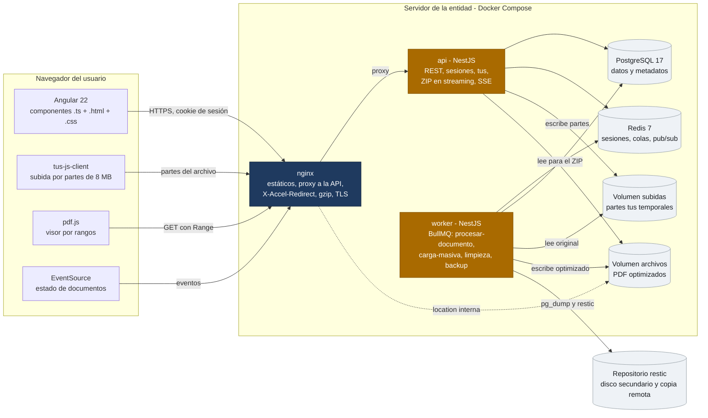

- El worker corre aparte de la API para que Ghostscript no frene las pantallas.
- La sesión va en cookie HttpOnly. Los enlaces de descarga y el visor la envían sin código adicional.
- Los PDF los entrega nginx con X-Accel-Redirect, con soporte de Range para el visor. La API solo valida permisos.
- El ZIP va en modo `store`: los PDF ya llegan optimizados desde la subida.
- Los archivos se guardan por trabajador y documento. Reclasificar un documento no mueve el archivo.
- Los documentos no se borran: se anulan con motivo.

## Despliegue

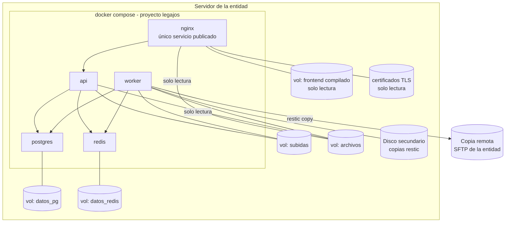

- Solo nginx publica puertos. PostgreSQL y Redis quedan en la red interna de Compose.
- La imagen del `worker` incluye `ghostscript`, `qpdf`, `restic` y `postgresql-client-17`. La imagen de la `api` no los necesita.
- La API monta el volumen de archivos en solo lectura. Solo el worker escribe ahí.

## Estructura del legajo

Cada trabajador tiene una ficha de datos y 12 secciones de documentos, según el catálogo «Contenido de las secciones del legajo».

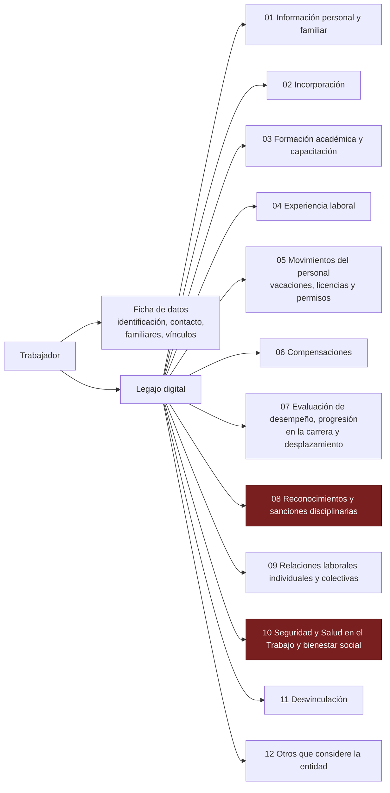

En rojo, las secciones restringidas: todos sus tipos se guardan como Restringido o Muy restringido.

### Reglas de clasificación

| Documento | Dónde va |
|---|---|
| Contratos con número (CAS N.° 036-2022) | Tipo 0206 Contrato, con `036-2022` en el campo número |
| Tipo de personal, régimen, cargo, área y fecha de ingreso | Campos de la ficha y del vínculo, no se suben como PDF |
| Ficha de datos del servidor civil | 0101, solo texto: es la ficha de la Sección 01, no se sube como PDF |
| Resoluciones de designación, renovación y del servicio civil de carrera | 02 Incorporación |
| Vacaciones, licencias y permisos | 05 Movimientos del personal |
| Designación, rotación, destaque y encargo | 07 Evaluación de desempeño, progresión en la carrera y desplazamiento |
| Descansos médicos | 10, restringido |
| Constancias y certificados de trabajo | 04 Experiencia laboral |
| Memorandos | Según su finalidad: funciones en la 04, desplazamiento en la 07, felicitación en la 08, término de vínculo en la 11 |

### Catálogo de tipos de documento

Código de cuatro dígitos: sección y tipo. R = restringido, Nº = número obligatorio, V = tiene vencimiento. El administrador puede agregar, desactivar o reordenar tipos. Los tipos del catálogo anterior quedaron inactivos con códigos que empiezan en 9.

**01 Información personal y familiar** (carpeta `01_Informacion_Personal_y_Familiar`)

| Código | Tipo | R | Nº | V |
|---|---|---|---|---|
| 0101 | Ficha de datos del servidor civil (SOLO TEXTO) | | | |
| 0102 | Copia del DNI o documento equivalente | | | Sí |
| 0103 | Declaración jurada o certificado de antecedentes penales | | | |
| 0104 | Declaración jurada o certificado de antecedentes policiales | | | |
| 0105 | Declaración jurada de bienes y rentas, cuando corresponda | | | |
| 0106 | Declaración jurada de no tener impedimentos para designación, según Ley N.º 31419 | | | |
| 0107 | Partida de matrimonio o constancia de unión de hecho | | | |
| 0108 | Información de impedimentos e inhabilitaciones (RNSSC, REDJUM, entre otros) | | | |
| 0109 | Copia del DNI del cónyuge o conviviente | | | |
| 0110 | Copia del DNI de los hijos menores de edad | | | |
| 0111 | Certificado de discapacidad emitido por CONADIS, cuando corresponda | | | |
| 0112 | Otras declaraciones juradas que correspondan | | | |

**02 Incorporación** (carpeta `02_Incorporacion`)

| Código | Tipo | R | Nº | V |
|---|---|---|---|---|
| 0201 | Resultado final del proceso de selección donde el servidor resultó ganador | | | |
| 0202 | Informe de Recursos Humanos que verifica el cumplimiento de los requisitos del puesto, cuando corresponda | | | |
| 0203 | Resolución administrativa de designación | | Sí | |
| 0204 | Resolución administrativa de renovación | | Sí | |
| 0205 | Resolución administrativa del servicio civil de carrera | | Sí | |
| 0206 | Contrato | | Sí | |
| 0207 | Adenda | | Sí | |
| 0208 | Registro de inducción general y específica | | | |
| 0209 | Cargo de entrega del perfil del puesto y funciones | | | |
| 0210 | Cargo de entrega del reglamento interno de servidores civiles | | | |
| 0211 | Cargo de entrega del código de conducta y ética | | | |
| 0212 | Otros documentos similares | | | |
| 0213 | Evaluación y resultados del período de prueba | | | |

Las resoluciones 0203 a 0205, el contrato y la adenda crean o actualizan el vínculo laboral de la ficha.

**03 Formación académica y capacitación** (carpeta `03_Formacion_Academica_y_Capacitacion`)

| Código | Tipo | R | Nº | V |
|---|---|---|---|---|
| 0301 | Certificado oficial de estudios básicos, cuando corresponda | | | |
| 0302 | Títulos o grados de estudios superiores técnicos o universitarios | | | |
| 0303 | Colegiatura y habilitación profesional | | | Sí |
| 0304 | Certificados o diplomas de postgrado (diplomados o programas de especialización) | | | |
| 0305 | Diploma de grado académico de Maestría o Doctorado | | | |
| 0306 | Certificados, constancias o diplomas de cursos y programas de capacitación | | | |
| 0307 | Constancias de participación en congresos, convenciones, seminarios, talleres, fórums, simposios, conferencias, charlas y similares | | | |
| 0308 | Otros documentos relacionados con la formación académica y capacitación | | | |

**04 Experiencia laboral** (carpeta `04_Experiencia_Laboral`)

| Código | Tipo | R | Nº | V |
|---|---|---|---|---|
| 0401 | Certificados de trabajo | | | |
| 0402 | Constancias de trabajo | | | |
| 0403 | Otros documentos que acrediten el tiempo de servicio | | | |
| 0404 | Resoluciones que acrediten funciones desempeñadas | | | |
| 0405 | Memorandos que acrediten asignación de funciones | | | |
| 0406 | Otros documentos que acrediten funciones desempeñadas | | | |

**05 Movimientos del personal: vacaciones, licencias y permisos** (carpeta `05_Movimientos_del_Personal`)

| Código | Tipo | R | Nº | V |
|---|---|---|---|---|
| 0501 | Documento que aprueba una licencia o permiso | | | |
| 0502 | Documento que sustenta el goce vacacional | | | |
| 0503 | Documento de adelanto de vacaciones | | | |
| 0504 | Documento de postergación de vacaciones | | | |
| 0505 | Rol de vacaciones | | | |
| 0506 | Licencia por maternidad | | | |
| 0507 | Licencia por paternidad | | | |
| 0508 | Licencia por lactancia | | | |
| 0509 | Licencia por adopción | | | |
| 0510 | Licencia sindical | | | |
| 0511 | Licencia por enfermedad de familiar grave | | | |
| 0512 | Licencia por participación en comité SST | | | |
| 0513 | Licencia por asistencia médica a un familiar | | | |
| 0514 | Licencia por servicio como bombero voluntario | | | |
| 0515 | Otras licencias otorgadas | | | |

**06 Compensaciones** (carpeta `06_Compensaciones`)

| Código | Tipo | R | Nº | V |
|---|---|---|---|---|
| 0601 | Documento de reconocimiento de tiempo de servicios | | | |
| 0602 | Documentación referente al pago de compensaciones económicas | | | |
| 0603 | Documentación referente a compensaciones no económicas | | | |
| 0604 | Certificado de retención de quinta categoría | | | |
| 0605 | Certificado de retención de cuarta categoría | | | |
| 0606 | Otros certificados de retención, cuando corresponda | | | |
| 0607 | Liquidación de beneficios sociales | | | |

**07 Evaluación de desempeño, progresión en la carrera y desplazamiento** (carpeta `07_Desempeno_Carrera_y_Desplazamiento`)

| Código | Tipo | R | Nº | V |
|---|---|---|---|---|
| 0701 | Formato para la gestión del rendimiento | | | |
| 0702 | Registro de evidencias de evaluación | | | |
| 0703 | Formato de reunión de seguimiento | | | |
| 0704 | Notificación de evaluación obtenida | | | |
| 0705 | Acta de retroalimentación de resultados | | | |
| 0706 | Plan de mejora del desempeño | | | |
| 0707 | Resolución de progresión en la carrera | | | |
| 0708 | Documento de designación | | | |
| 0709 | Documento de rotación | | | |
| 0710 | Documento de destaque | | | |
| 0711 | Documento de encargo de puestos o funciones | | | |
| 0712 | Otros documentos de desplazamiento | | | |

Los tipos 0708 a 0712 se confirman como movimiento laboral y actualizan el área de la ficha.

**08 Reconocimientos y sanciones disciplinarias** (carpeta `08_Reconocimientos_y_Sanciones`)

| Código | Tipo | R | Nº | V |
|---|---|---|---|---|
| 0801 | Carta de felicitación | Sí | | |
| 0802 | Oficio de felicitación | Sí | | |
| 0803 | Memorando de felicitación | Sí | | |
| 0804 | Condecoración | Sí | | |
| 0805 | Diploma por reconocimiento de participación excepcional en proyectos o eventos | Sí | | |
| 0806 | Certificado o constancia de reconocimiento excepcional por labor docente | Sí | | |
| 0807 | Certificado o constancia de reconocimiento por tiempo de servicios | Sí | | |
| 0808 | Documento de amonestación escrita | Sí | | |
| 0809 | Documento de suspensión | Sí | | |
| 0810 | Documento de destitución | Sí | | |
| 0811 | Documento que declara fundado un recurso impugnatorio | Sí | | |
| 0812 | Documento que declara infundado un recurso impugnatorio | Sí | | |
| 0813 | Documento que declara improcedente un recurso impugnatorio | Sí | | |

**09 Relaciones laborales individuales y colectivas** (carpeta `09_Relaciones_Laborales`)

| Código | Tipo | R | Nº | V |
|---|---|---|---|---|
| 0901 | Documentación relacionada con controversias individuales | | | |
| 0902 | Documentación relacionada con controversias colectivas | | | |
| 0903 | Resolución que indique la afiliación sindical | | | |
| 0904 | Acta que indique la afiliación sindical | | | |
| 0905 | Otro documento que indique la afiliación sindical | | | |

**10 Seguridad y Salud en el Trabajo (SST) y bienestar social** (carpeta `10_SST_y_Bienestar_Social`)

| Código | Tipo | R | Nº | V |
|---|---|---|---|---|
| 1001 | Cargo de entrega del Reglamento de Seguridad y Salud en el Trabajo | Sí | | |
| 1002 | Registro de entrenamiento y simulacros de emergencia | Sí | | |
| 1003 | Lista de asistencia a capacitaciones brindadas por la entidad pública | Sí | | |
| 1004 | Documentos de trámites y gestiones de seguros | Sí | | |
| 1005 | Documentos de trámites y gestiones de subsidios | Sí | | |
| 1006 | Documentos de descansos médicos | Sí | | |
| 1007 | Documentos de afiliación a Entidades Prestadoras de Salud (EPS) | Sí | | |

**11 Desvinculación** (carpeta `11_Desvinculacion`)

| Código | Tipo | R | Nº | V |
|---|---|---|---|---|
| 1101 | Resolución de término de designación | | | |
| 1102 | Resolución de término del servicio civil de carrera | | | |
| 1103 | Memorando de término de vínculo del servicio civil | | | |
| 1104 | Informe de gestión | | | |
| 1105 | Documento de entrega de cargo o puesto | | | |
| 1106 | Liquidación de beneficios sociales y/o pensión | | | |
| 1107 | Carta de no renovación de contrato a plazo determinado (D. Leg. N.º 1057) | | | |

Los tipos 1101, 1102, 1103 y 1107 sustentan la confirmación del cese.

**12 Otros que considere la entidad** (carpeta `12_Otros_que_Considere_la_Entidad`)

| Código | Tipo | R | Nº | V |
|---|---|---|---|---|
| 1201 | Otros documentos administrativos del trabajador | | | |
| 1202 | Comunicaciones administrativas relevantes | | | |
| 1203 | Informes relacionados con la trayectoria laboral | | | |
| 1204 | Documentos complementarios de recursos humanos | | | |
| 1205 | Documentación de fiscalización posterior | | | |
| 1206 | Otros documentos no clasificados | | | |

### Campos propios por sección

Además de tipo, número, fecha de emisión, vencimiento, emisor, observaciones y ubicación física, cada sección pide sus propios datos. Se guardan en `documento.datos`. Al subir un PDF el formulario queda bloqueado hasta elegir el tipo de documento; luego aparecen los campos de la sección y los del tipo elegido.

| Sección | Campos |
|---|---|
| 02 | En resoluciones, contrato y adenda: tipo de incorporación, régimen, inicio, fin, dependencia y puesto |
| 03 | Institución emisora, carrera o curso, fecha de culminación, colegio profesional, número de colegiatura |
| 04 | Entidad donde trabajó, cargo desempeñado, inicio y fin del período |
| 05 | Categoría (vacaciones, licencia, permiso u otro), fecha de inicio, fecha de término |
| 06 | Concepto, período de referencia, fecha de efecto, referencia administrativa |
| 07 | Período evaluado, cargo evaluado, resultado, área evaluadora; en desplazamientos, también tipo de movimiento, áreas de origen y destino y fecha efectiva |
| 08 | Categoría (reconocimiento, sanción, actuación disciplinaria), autoridad emisora, fecha de efecto |
| 09 | Materia, instancia participante, fecha de reunión, número de expediente |
| 10 | Categoría SST, área responsable |
| 11 | Motivo de cese, fecha efectiva, sustento, área que tramita |
| 12 | Categoría propuesta, justificación (obligatoria), oficina emisora |

Cada tipo suma sus datos adicionales: concurso y resultado en la selección, grado y registro SUNEDU en títulos, colegio y vigencia en la colegiatura, horas y modalidad en cursos, documento que autoriza la ausencia en la 05, acto de sustento y monto en la 06, proceso y resultado en la 07, acto resolutivo en la 08, asunto y expediente en la 09, código SST y vigencia en la 10.

Nivel de acceso por documento: **Restringido** (Administrador y Operador) o **Muy restringido** (solo Administrador). Los tipos marcados con R nunca bajan de Restringido. En la sección 10 no se registran diagnósticos ni datos clínicos en campos abiertos.

## Módulos

| Módulo | Función |
|---|---|
| Usuarios | Crear usuarios, roles y permisos |
| Personal | Registrar trabajadores, familiares y vínculos laborales |
| Legajo | Consultar el expediente completo por secciones, ver y descargar documentos |
| Documentos | Subir PDFs y clasificarlos, de uno en uno o por carga masiva |
| Búsqueda | Por DNI, nombre, documento y fecha |
| Reportes | Listados y documentos faltantes |
| Auditoría | Registrar quién realizó cada acción |
| Backup | Copias de seguridad |
| Catálogos | Secciones, tipos de documento, documentos obligatorios, regímenes, áreas y cargos (lo administra el rol Administrador) |

## Modelo de datos

```mermaid
erDiagram
    ROL ||--o{ USUARIO : "asignado a"
    ROL ||--o{ ROL_PERMISO : agrupa
    PERMISO ||--o{ ROL_PERMISO : "incluido en"

    TRABAJADOR ||--o{ FAMILIAR : registra
    TRABAJADOR ||--o{ VINCULO : tiene
    REGIMEN ||--o{ VINCULO : clasifica
    CARGO ||--o{ VINCULO : ocupa
    AREA ||--o{ VINCULO : "ubica en"
    AREA |o--o{ AREA : "depende de"

    SECCION ||--|{ TIPO_DOCUMENTO : agrupa
    TIPO_DOCUMENTO ||--o{ REQUISITO : "es exigido por"
    REGIMEN |o--o{ REQUISITO : "filtra"

    TRABAJADOR ||--o{ DOCUMENTO : "legajo de"
    TIPO_DOCUMENTO ||--o{ DOCUMENTO : clasifica
    DOCUMENTO ||--|{ DOCUMENTO_ARCHIVO : versiones
    USUARIO ||--o{ DOCUMENTO : registra
    USUARIO ||--o{ DOCUMENTO_ARCHIVO : sube

    USUARIO ||--o{ LOTE_CARGA : crea
    LOTE_CARGA ||--|{ LOTE_ITEM : contiene
    LOTE_ITEM |o--o{ DOCUMENTO : origina
    TRABAJADOR |o--o{ LOTE_ITEM : "se asigna a"
    TIPO_DOCUMENTO |o--o{ LOTE_ITEM : "se clasifica como"

    USUARIO |o--o{ AUDITORIA : genera
    TRABAJADOR |o--o{ AUDITORIA : "afecta a"
    USUARIO |o--o{ BACKUP_EJECUCION : "lanza manualmente"
    USUARIO ||--o{ CODIGO_RECUPERACION : solicita

    USUARIO {
        uuid id PK
        varchar usuario UK
        varchar nombre_completo
        varchar correo UK "para iniciar sesión y recuperar la clave"
        text clave_hash "argon2id"
        uuid rol_id FK
        bool activo
        int intentos_fallidos
        timestamptz bloqueado_hasta
        bool debe_cambiar_clave
        timestamptz ultimo_acceso
        timestamptz creado_en
        timestamptz actualizado_en
    }
    ROL {
        uuid id PK
        varchar nombre UK
        text descripcion
        bool es_sistema "no se puede borrar"
    }
    PERMISO {
        varchar codigo PK "ej. documentos.subir"
        varchar modulo
        text descripcion
    }
    ROL_PERMISO {
        uuid rol_id PK, FK
        varchar permiso_codigo PK, FK
    }
    REGIMEN {
        int id PK
        varchar codigo UK "DL276, DL728, DL1057, L30057, LOCACION"
        varchar nombre
        bool es_laboral "false en locación"
        bool activo
    }
    AREA {
        int id PK
        varchar nombre
        int padre_id FK "dependencia superior"
        bool activo
    }
    CARGO {
        int id PK
        varchar nombre UK
        bool activo
    }
    TRABAJADOR {
        uuid id PK
        varchar tipo_doc_identidad "DNI o CE"
        varchar numero_doc UK
        varchar apellido_paterno
        varchar apellido_materno
        varchar nombres
        text nombre_busqueda "columna generada sin tildes"
        date fecha_nacimiento
        varchar sexo
        varchar estado_civil
        text direccion
        varchar departamento
        varchar provincia
        varchar distrito
        varchar telefono
        varchar correo
        date fecha_ingreso "ingreso a la institución"
        varchar estado "ACTIVO o CESADO"
        varchar movimiento_actual "SIN_MOVIMIENTO, ROTACION, DESTAQUE, ENCARGATURA, REASIGNACION"
        date movimiento_fecha
        timestamptz creado_en
        timestamptz actualizado_en
    }
    FAMILIAR {
        uuid id PK
        uuid trabajador_id FK
        varchar parentesco
        varchar numero_doc
        varchar nombres_apellidos
        date fecha_nacimiento
    }
    VINCULO {
        uuid id PK
        uuid trabajador_id FK
        int regimen_id FK
        varchar tipo_personal "ADMINISTRATIVO o ASISTENCIAL"
        int cargo_id FK
        int area_id FK
        date fecha_inicio
        date fecha_fin "nulo mientras está vigente"
        varchar motivo_fin
        varchar referencia "documento de sustento"
        bool actual "uno por trabajador, se conserva al cesar"
    }
    SECCION {
        int id PK
        int numero UK "1 a 12"
        varchar nombre
        varchar carpeta "nombre de carpeta en el ZIP"
        text descripcion
        jsonb campos "campos propios de la sección"
    }
    CODIGO_RECUPERACION {
        uuid id PK
        uuid usuario_id FK
        char codigo_hash "SHA-256 del código de 6 dígitos"
        timestamptz expira_en "10 minutos"
        int intentos "máximo 5"
        timestamptz usado_en
        inet ip
        timestamptz creado_en
    }
    TIPO_DOCUMENTO {
        int id PK
        int seccion_id FK
        varchar codigo UK "4 dígitos"
        varchar nombre
        bool restringido
        bool requiere_numero
        bool tiene_vencimiento
        bool activo
        int orden
    }
    REQUISITO {
        int id PK
        int tipo_documento_id FK
        int regimen_id FK "nulo = todos"
        varchar tipo_personal "nulo = ambos"
        varchar aplica_a "ACTIVO, CESADO o TODOS"
    }
    DOCUMENTO {
        uuid id PK
        uuid trabajador_id FK
        int tipo_documento_id FK
        varchar numero
        date fecha_emision
        date fecha_vencimiento
        varchar emisor
        text observaciones
        varchar ubicacion_fisica "caja o archivador del original"
        jsonb datos "campos propios de la sección"
        varchar nivel_acceso "NORMAL, RESTRINGIDO, MUY_RESTRINGIDO"
        varchar estado "PROCESANDO, DISPONIBLE, ERROR, ANULADO"
        text detalle_error
        text motivo_anulacion
        uuid archivo_actual_id FK
        uuid lote_item_id FK "si vino de una carga masiva"
        uuid creado_por FK
        timestamptz creado_en
        uuid modificado_por FK
        timestamptz modificado_en
        text motivo_modificacion
        timestamptz actualizado_en
    }
    DOCUMENTO_ARCHIVO {
        uuid id PK
        uuid documento_id FK
        int version
        varchar ruta "relativa al volumen archivos"
        bigint tamano_original
        bigint tamano_final
        char hash_original "SHA-256 del PDF subido"
        char hash_final "SHA-256 del PDF guardado"
        int paginas "folios"
        bool optimizado
        uuid subido_por FK
        timestamptz creado_en
    }
    LOTE_CARGA {
        uuid id PK
        uuid usuario_id FK
        varchar estado "SUBIENDO, EN_BANDEJA, TERMINADO"
        int total
        int clasificados
        int pendientes
        int con_error
        timestamptz creado_en
        timestamptz terminado_en
    }
    LOTE_ITEM {
        uuid id PK
        uuid lote_id FK
        int orden
        varchar nombre_archivo
        bigint tamano
        varchar subida_id "id tus"
        uuid trabajador_id FK
        int tipo_documento_id FK
        varchar estado "SUBIENDO, PENDIENTE, CLASIFICADO, DIVIDIDO, ERROR"
        varchar motivo
        timestamptz creado_en
        timestamptz actualizado_en
    }
    AUDITORIA {
        bigint id PK
        timestamptz fecha
        uuid usuario_id FK
        varchar accion
        varchar entidad
        varchar entidad_id
        uuid trabajador_id FK "para filtrar por legajo"
        inet ip
        text user_agent
        jsonb detalle "antes y después, filtros, lista de documentos"
    }
    BACKUP_EJECUCION {
        uuid id PK
        varchar origen "PROGRAMADO o MANUAL"
        uuid usuario_id FK
        timestamptz inicio
        timestamptz fin
        varchar estado "EN_CURSO, CORRECTO, ERROR"
        varchar snapshot_bd
        varchar snapshot_archivos
        bigint bytes_agregados
        bool verificado
        text error
    }
```

Restricciones e índices que se crean con SQL en las migraciones:

| Objeto | Definición | Para qué |
|---|---|---|
| `f_unaccent(text)` | Envoltorio `IMMUTABLE` de `unaccent` | Permite usar `unaccent` en columnas generadas e índices |
| `trabajador.nombre_busqueda` | Columna generada: `lower(f_unaccent(apellido_paterno || ' ' || apellido_materno || ' ' || nombres))` | Búsqueda sin tildes ni mayúsculas |
| `ix_trabajador_nombre_trgm` | GIN `gin_trgm_ops` sobre `nombre_busqueda` | Búsqueda parcial por nombre |
| `ux_trabajador_doc` | Único sobre `(tipo_doc_identidad, numero_doc)` | Un trabajador por documento de identidad |
| `ux_vinculo_actual` | Único parcial sobre `trabajador_id` donde `actual` | Un solo vínculo actual por trabajador; si no tiene fecha de fin, está vigente |
| `ix_documento_numero_trgm` | GIN `gin_trgm_ops` sobre `lower(numero)` | Búsqueda por número de documento |
| `ix_documento_legajo` | B-tree sobre `(trabajador_id, tipo_documento_id, fecha_emision)` | Carga del legajo ordenado |
| `ix_documento_fecha` | B-tree sobre `fecha_emision` | Búsqueda por rango de fechas |
| `ux_archivo_hash` | Único sobre `(documento_id, hash_original)` | Impide subir dos veces el mismo PDF como versión del mismo documento |
| `ix_archivo_hash_original` | B-tree sobre `hash_original` | Detección de duplicados dentro del legajo |
| `ix_auditoria_legajo` | B-tree sobre `(trabajador_id, fecha DESC)` | Historial de un legajo |
| `ix_auditoria_usuario` | B-tree sobre `(usuario_id, fecha DESC)` | Actividad de un usuario |
| `tg_auditoria_inmutable` | Trigger `BEFORE UPDATE OR DELETE` que lanza una excepción | La auditoría no se puede modificar ni borrar |
| `tg_documento_archivo_inmutable` | Trigger `BEFORE UPDATE OR DELETE` | Las versiones de archivo no se modifican: se agrega una nueva |

## Ciclos de vida

### Trabajador y vínculo

Trabajador:

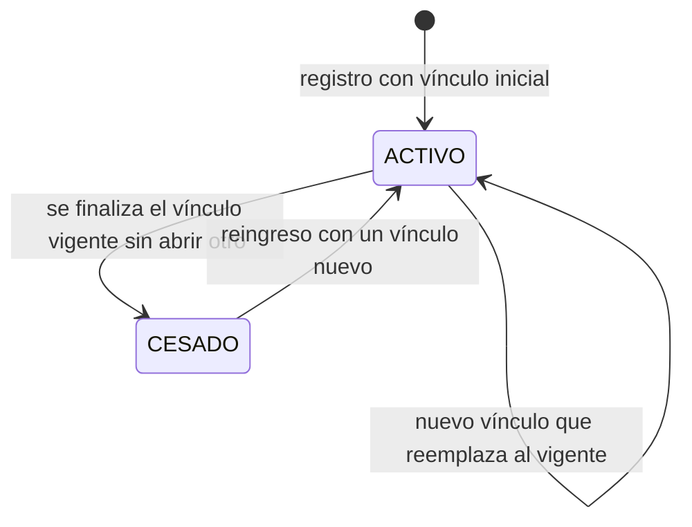

Vínculo:

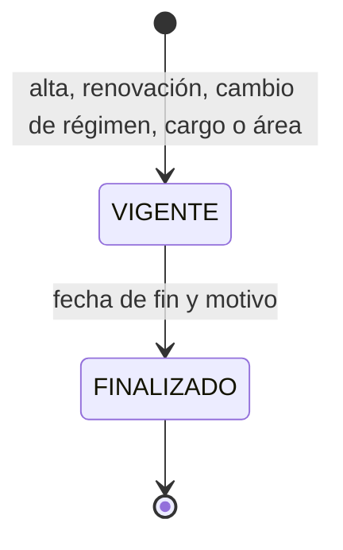

Motivos de cese: `RENUNCIA`, `JUBILACION`, `FALLECIMIENTO`, `FIN_CONTRATO`, `DESTITUCION`, `OTRA_CAUSA`. Motivos de fin de vínculo sin cese: `RENOVACION`, `CAMBIO_REGIMEN`, `CAMBIO_CARGO_O_AREA`.

- El reingreso exige una fecha posterior al último cese y no se permite si el motivo fue fallecimiento.
- El movimiento actual (rotación, destaque, encargatura, reasignación) no es un estado laboral: un trabajador rotado sigue ACTIVO. Se actualiza con la fecha del movimiento y su sustento va en la sección 07.
- Registrar un PDF de cese no cambia el estado: el cese se registra en la ficha con motivo y fecha.
- «Renovación o continuidad» no exige cese. Si el contrato empieza después del período actual, cierra ese período el día anterior (por renovación, cambio de régimen o cambio de cargo o área, según lo que cambie) y abre uno nuevo con el régimen, área y cargo del contrato; el trabajador sigue ACTIVO y conserva su fecha de ingreso. Si empieza el mismo día, se suma al período actual.
- Un reingreso cuyo contrato empieza al día siguiente del fin del anterior se registra como continuidad: el período previo queda cerrado por renovación, no por fin de contrato.
- El contrato manda sobre el estado. Los contratos, adendas y resoluciones de la sección 02 llevan fecha de fin; la más lejana entre los enlazados al vínculo actual es el fin del contrato vigente y se muestra en la ficha. Cuando esa fecha ya pasó, el trabajador queda CESADO por `FIN_CONTRATO` en esa fecha: al registrar el contrato si ya venció, o en la revisión diaria del worker cuando vence después. Un contrato posterior se registra como reingreso y vuelve a activarlo.

El trabajador no se borra. Al cesar, su legajo sigue consultable y en faltantes se le exigen los documentos de cese.

### Documento

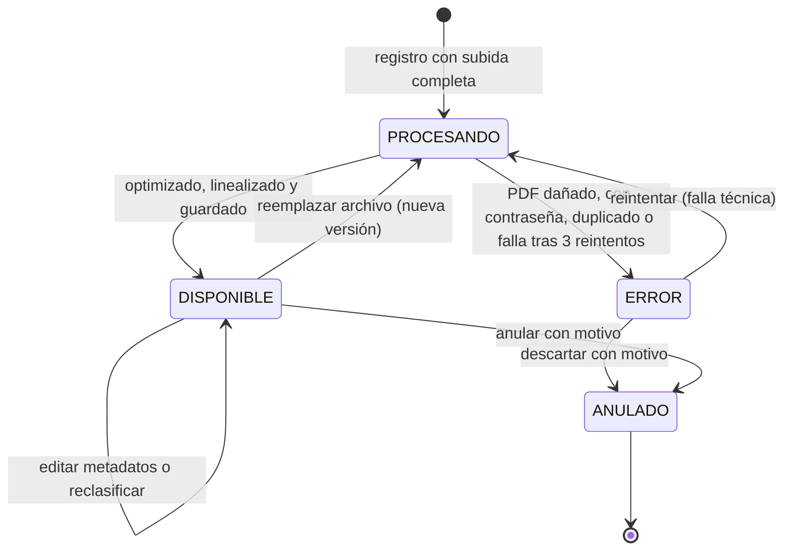

- Mientras un reemplazo está en proceso, la versión anterior sigue visible.
- Un documento anulado no aparece en el legajo ni en las descargas, pero lo pueden ver con un filtro los roles con permiso `documentos.anular`.

## Flujos

### Alta de trabajador y cese

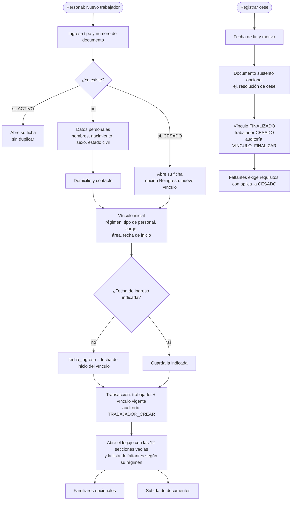

### Inicio de sesión

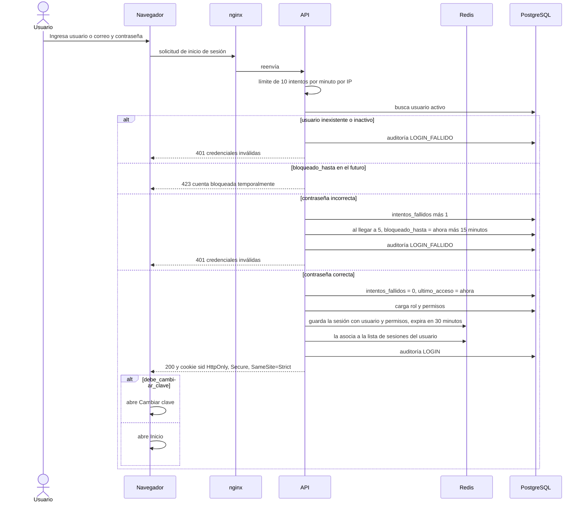

- La sesión se renueva con cada petición y expira tras 30 minutos sin actividad.
- Al cambiar el rol de un usuario o los permisos de un rol, se cierran las sesiones afectadas y el cambio rige de inmediato.
- Al cerrar sesión se borra la clave en Redis y se registra `LOGOUT`.
- El Administrador puede desbloquear una cuenta antes de los 15 minutos.

### Recuperación de contraseña

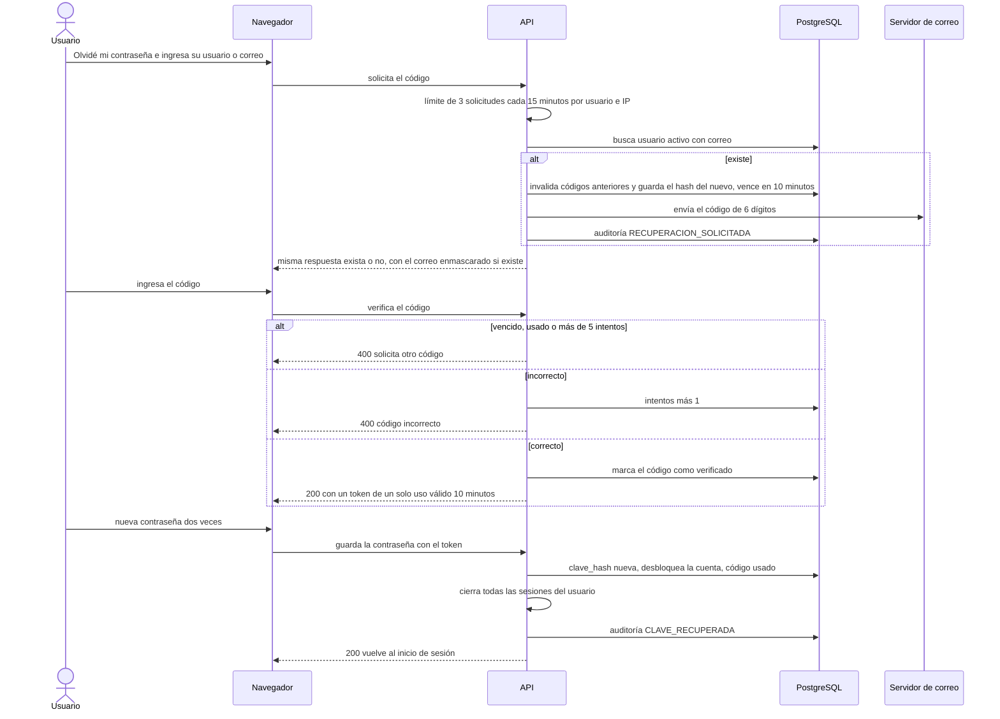

### Autorización de cada petición

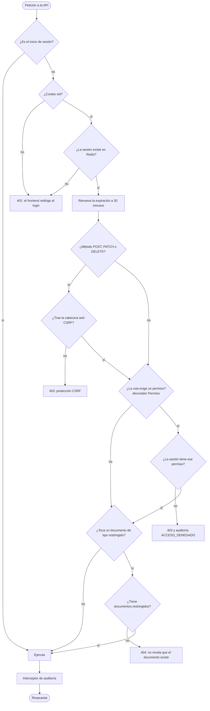

Sin `documentos.restringidos`, los tipos restringidos se filtran en SQL: no salen en el legajo, la búsqueda, los conteos ni los ZIP.

### Subida de un documento

El archivo se empieza a subir al soltarlo, mientras el operador llena los datos.

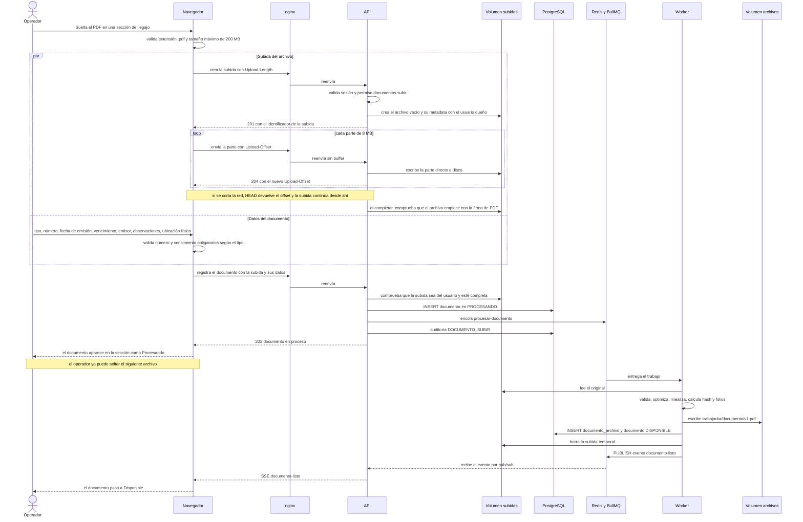

- Hasta 3 archivos en paralelo; el resto queda en cola con barra de progreso.
- Las subidas pasan por nginx con `proxy_request_buffering off` y `client_max_body_size 10m`.
- Una subida que no se registra como documento en 24 horas la borra el trabajo `limpiar-subidas`, que corre cada hora.

### Procesamiento del PDF en el worker

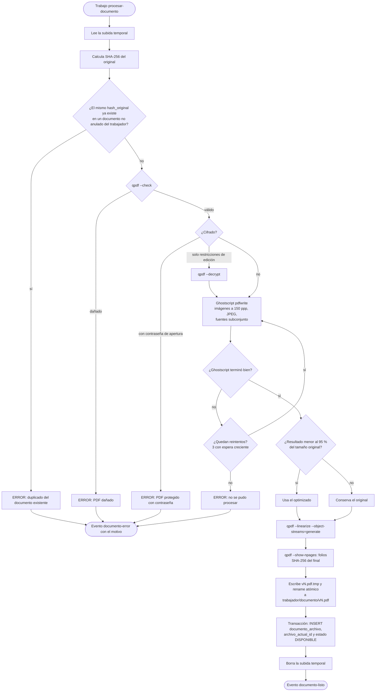

Parámetros de Ghostscript:

```
gs -sDEVICE=pdfwrite -dCompatibilityLevel=1.7 -dPDFSETTINGS=/ebook
   -dDownsampleColorImages=true -dColorImageResolution=150
   -dDownsampleGrayImages=true -dGrayImageResolution=150
   -dDownsampleMonoImages=true -dMonoImageResolution=300
   -dDetectDuplicateImages=true -dSubsetFonts=true
   -dNOPAUSE -dBATCH -dSAFER -dQUIET
   -sOutputFile=<salida> <entrada>
```

- En escala de grises se agregan `-sColorConversionStrategy=Gray -dProcessColorModel=/DeviceGray`. Por defecto se mantiene el color (sellos y firmas).
- Resolución configurable, 150 ppp por defecto.
- Concurrencia configurable, por defecto núcleos menos uno.
- Del original solo se guarda el hash.

### Carga masiva

Para digitalizar los legajos en papel. Se selecciona una carpeta o varios PDFs.

Convención de nombres:

```
<DNI>_<CÓDIGO>[_<NÚMERO>][_<AAAAMMDD>].pdf

45781236_0102.pdf                          DNI del trabajador
45781236_0206_036-2022_20220115.pdf        Contrato N.° 036-2022 del 15/01/2022
45781236_0302_20190520.pdf                 Título profesional del 20/05/2019
```

La fecha siempre va al final. Si hay un solo dato después del código y es una fecha válida de 8 dígitos, se toma como fecha; si no, como número.

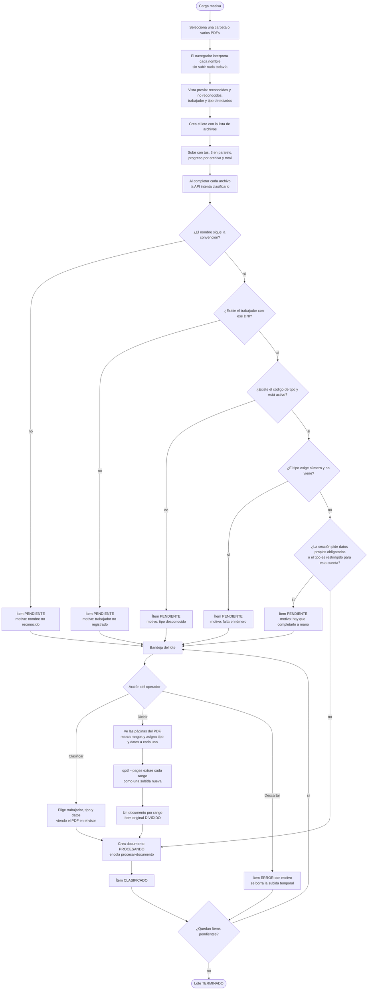

- Dividir: para cuando el escáner saca un solo PDF con todo el legajo.
- Cada PDF del lote pasa por el mismo procesamiento que una subida individual.
- Los totales del lote alimentan el reporte de digitalización.
- Si un archivo no termina de subirse en 24 horas, su ítem queda en ERROR y se libera el espacio.

### Ver y descargar un documento

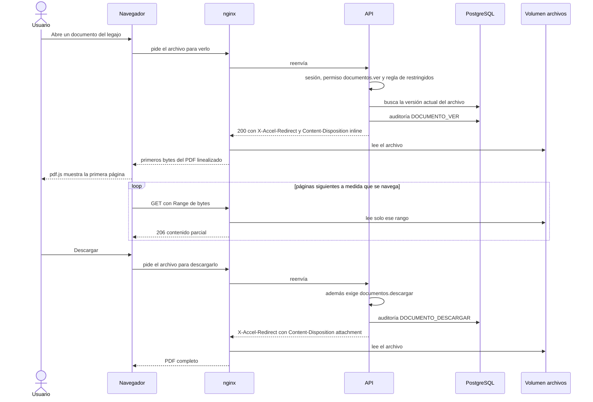

- La location de archivos es `internal` en nginx.
- Nombre de descarga: `<CÓDIGO>_<TIPO>_<NÚMERO>_<AAAA-MM-DD>.pdf`.

### Descarga comprimida en ZIP

Legajo completo, secciones marcadas o documentos seleccionados.

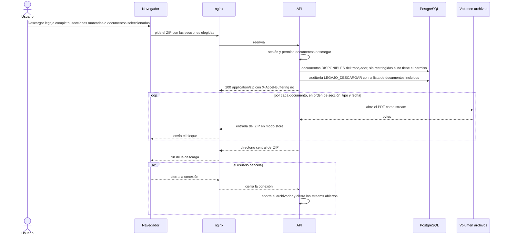

Estructura del ZIP:

```
45781236_PEREZ_QUISPE_JUAN.zip
└── 45781236_PEREZ_QUISPE_JUAN/
    ├── 01_Informacion_Personal_y_Familiar/
    │   ├── 0102_Copia_del_DNI_o_documento_equivalente.pdf
    │   └── 0103_Declaracion_jurada_o_certificado_de_antecedentes_penales.pdf
    ├── 02_Incorporacion/
    │   ├── 0201_Resultado_final_del_proceso_de_seleccion.pdf
    │   ├── 0206_Contrato_036-2022_2022-01-15.pdf
    │   └── 0207_Adenda_0089-2022_2022-03-01.pdf
    └── 03_Formacion_Academica_y_Capacitacion/
        └── 0302_Titulos_o_grados_de_estudios_superiores_2019-05-20.pdf
```

- Sin archivos temporales; memoria constante.
- Nombres repetidos llevan sufijo `_2`, `_3`.
- Los documentos seleccionados pueden ser de varios trabajadores.

### Búsqueda

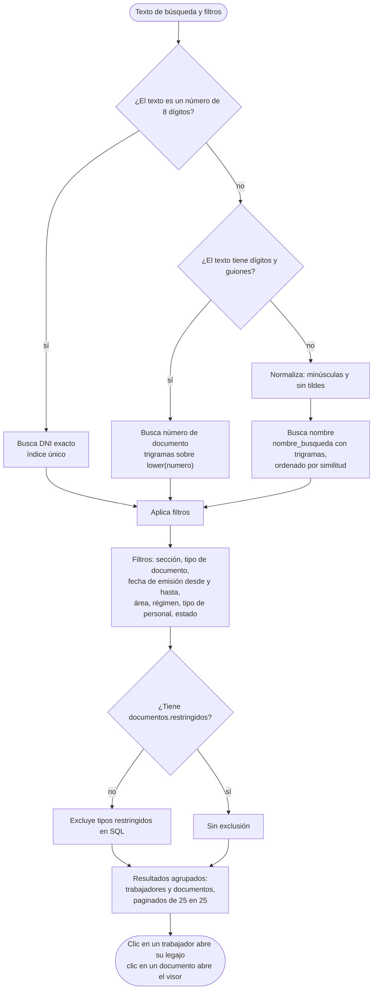

Búsqueda rápida en la cabecera de todas las pantallas: se abre con Ctrl K, espera un cuarto de segundo desde la última tecla y muestra hasta seis trabajadores y cuatro documentos, con una última opción que lleva a la búsqueda avanzada. Cuando el texto no es un documento de identidad ni un número, también se compara contra los nombres de cargo, área y tipo de documento, sin tildes.

La búsqueda avanzada tiene todos los filtros y descarga en ZIP los documentos marcados, hasta 100 por descarga, en carpetas por trabajador y sección.

### Documentos faltantes

Los obligatorios se configuran en Catálogos > Documentos obligatorios, por régimen, tipo de personal y estado del trabajador.

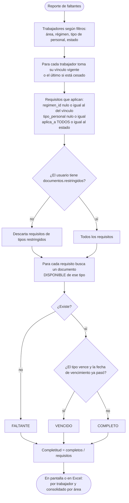

Se calcula en una sola consulta con `LEFT JOIN` entre trabajadores, requisitos y documentos.

Requisitos iniciales de la semilla:

| Tipo | Régimen | Tipo de personal | Estado |
|---|---|---|---|
| 0102 Copia del DNI o documento equivalente | Todos | Ambos | Todos |
| 0206 Contrato | D. Leg. 1057 | Ambos | Todos |
| 0205 Resolución administrativa del servicio civil de carrera | D. Leg. 276 | Ambos | Todos |
| 0302 Títulos o grados de estudios superiores técnicos o universitarios | Todos | Asistencial | Todos |
| 1102 Resolución de término del servicio civil de carrera | D. Leg. 276 | Ambos | Cesado |
| 1107 Carta de no renovación de contrato a plazo determinado | D. Leg. 1057 | Ambos | Cesado |

### Auditoría

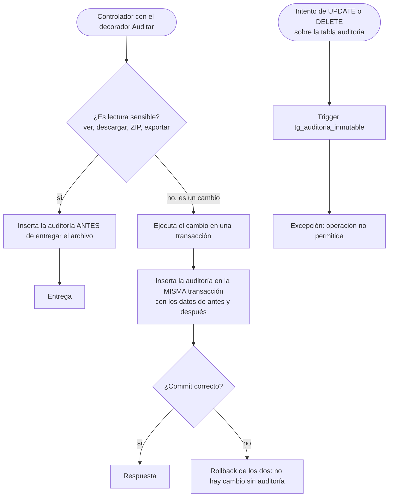

Acciones registradas:

| Módulo | Acciones |
|---|---|
| Sesión | `LOGIN`, `LOGIN_FALLIDO`, `LOGOUT`, `CLAVE_CAMBIAR`, `ACCESO_DENEGADO`, `RECUPERACION_SOLICITADA`, `CLAVE_RECUPERADA` |
| Usuarios | `USUARIO_CREAR`, `USUARIO_EDITAR`, `USUARIO_DESACTIVAR`, `USUARIO_ACTIVAR`, `USUARIO_DESBLOQUEAR`, `USUARIO_RESTABLECER_CLAVE`, `ROL_CREAR`, `ROL_EDITAR` |
| Catálogos | `CATALOGO_CREAR`, `CATALOGO_EDITAR`, `REQUISITO_CREAR`, `REQUISITO_EDITAR`, `REQUISITO_QUITAR` |
| Personal | `TRABAJADOR_CREAR`, `TRABAJADOR_EDITAR`, `FAMILIAR_CREAR`, `FAMILIAR_EDITAR`, `FAMILIAR_QUITAR`, `VINCULO_CREAR`, `VINCULO_FINALIZAR` |
| Documentos | `DOCUMENTO_SUBIR`, `DOCUMENTO_EDITAR`, `DOCUMENTO_RECLASIFICAR`, `DOCUMENTO_REEMPLAZAR`, `DOCUMENTO_ANULAR`, `DOCUMENTO_REINTENTAR`, `DOCUMENTO_VER`, `DOCUMENTO_DESCARGAR` |
| Legajo | `LEGAJO_VER`, `LEGAJO_DESCARGAR`, `DOCUMENTOS_DESCARGAR_SELECCION` |
| Carga masiva | `LOTE_CREAR`, `LOTE_ITEM_CLASIFICAR`, `LOTE_ITEM_DIVIDIR`, `LOTE_ITEM_DESCARTAR` |
| Reportes | `REPORTE_EXPORTAR` |
| Backup | `BACKUP_MANUAL`, `BACKUP_CORRECTO`, `BACKUP_ERROR` |

Cada registro: fecha, usuario, acción, entidad e id, trabajador, IP, navegador y detalle en JSON. Filtros por usuario, acción, trabajador y fechas, con exportación a Excel. En el legajo, la pestaña Historial muestra la auditoría del trabajador. No se depura.

### Copias de seguridad

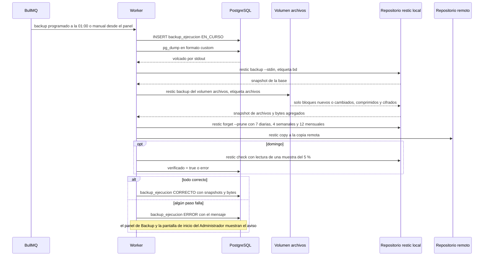

- Concurrencia 1.
- `pg_dump` corre en caliente.
- Copias cifradas.
- Panel: última copia, historial, snapshots, espacio usado y copia manual. La restauración se hace por consola.

### Restauración

```mermaid
flowchart TD
    A(["Script de restauración con la snapshot"]) --> B["Lista las snapshots si no se indica una"]
    B --> C["Confirmación escrita del operador"]
    C --> D["docker compose stop api worker"]
    D --> E["restic restore de archivos<br/>a una carpeta nueva"]
    E --> F["restic dump del volcado de la base"]
    F --> G["pg_restore --clean --if-exists"]
    G --> H["Cambia la carpeta de archivos por la restaurada<br/>la anterior queda renombrada con la fecha"]
    H --> I["docker compose start api worker"]
    I --> J["Verificación: cuenta documentos DISPONIBLES<br/>y comprueba que cada ruta exista en disco"]
    J --> K{"¿Coinciden?"}
    K -->|"sí"| L(["Restauración correcta"])
    K -->|"no"| M(["Reporte de rutas faltantes"])
```

## Roles y permisos

Roles en Usuarios > Roles. La semilla crea estos tres; se pueden crear otros.

| Permiso | Administrador | Operador | Consulta |
|---|---|---|---|
| `usuarios.gestionar` | Sí | No | No |
| `catalogos.gestionar` | Sí | No | No |
| `personal.ver` | Sí | Sí | Sí |
| `personal.editar` | Sí | Sí | No |
| `documentos.ver` | Sí | Sí | Sí |
| `documentos.subir` | Sí | Sí | No |
| `documentos.editar` | Sí | Sí | No |
| `documentos.anular` | Sí | Sí | No |
| `documentos.descargar` | Sí | Sí | Sí |
| `documentos.restringidos` | Sí | Sí | No |
| `documentos.muy_restringidos` | Sí | No | No |
| `carga_masiva.usar` | Sí | Sí | No |
| `reportes.ver` | Sí | Sí | Sí |
| `reportes.exportar` | Sí | Sí | Sí |
| `auditoria.ver` | Sí | No | No |
| `backup.gestionar` | Sí | No | No |

Reglas:

- El Operador edita o reclasifica solo lo que subió en las últimas 48 horas. Después, el Administrador.
- Editar los datos de un documento, reemplazarlo o anularlo exige un motivo, que queda en la auditoría.
- Nadie se quita a sí mismo `usuarios.gestionar` y siempre queda un Administrador activo.
- Los usuarios se desactivan, no se borran.

## Pantallas

```mermaid
flowchart LR
    LOGIN["Inicio de sesión"] --> CC["Cambiar clave<br/>primer ingreso"]
    LOGIN --> REC["Recuperar contraseña<br/>código al correo"]
    REC --> LOGIN
    LOGIN --> INI["Inicio<br/>total, activos, cesados,<br/>rotados, destacados,<br/>ingresos recientes"]
    INI --> PRF["Mi perfil<br/>datos y cambio de clave"]
    CC --> INI
    INI --> PER["Personal<br/>listado con filtros"]
    PER --> TRA["Trabajador<br/>ficha, familiares, vínculos"]
    TRA --> LEG["Legajo<br/>12 secciones, visor,<br/>subida, ZIP, historial"]
    PER --> LEG
    INI --> BUS["Búsqueda avanzada"]
    BUS --> LEG
    INI --> CM["Carga masiva<br/>nueva carga y lotes"]
    CM --> LOT["Lote<br/>bandeja, clasificar, dividir"]
    INI --> REP["Reportes<br/>personal, faltantes,<br/>digitalización, avance"]
    REP --> LEG
    INI --> AUD["Auditoría"]
    INI --> USU["Usuarios"]
    USU --> ROL["Roles"]
    INI --> CAT["Catálogos<br/>tipos, obligatorios,<br/>regímenes, áreas, cargos"]
    INI --> BAK["Backup"]
```

El menú se arma según los permisos. Cada pantalla tiene un guard con su permiso; sin permiso vuelve a Inicio.

### Pantalla del legajo

| Zona | Contenido |
|---|---|
| Cabecera | DNI, nombre, estado, régimen, tipo de personal, cargo, área, fecha de ingreso y completitud |
| Columna izquierda | 12 secciones en acordeón con conteo y faltantes; documentos por tipo y fecha con número, folios y estado |
| Panel derecho | Visor, datos, versiones y acciones: editar, reemplazar, anular, descargar |
| Barra de acciones | Subir (o soltar sobre una sección), ZIP del legajo, ZIP de secciones marcadas |
| Pestañas | Documentos, Faltantes, Vínculos, Historial |

### Componentes reutilizables

| Selector | Función |
|---|---|
| `app-cabecera` | Logo, búsqueda global, usuario y cierre de sesión |
| `app-menu` | Menú lateral filtrado por permisos |
| `app-tabla-datos` | Tabla con paginación, orden y filtros desde la API |
| `app-visor-pdf` | pdf.js con zoom, páginas y miniaturas; también lo usa la división de PDFs |
| `app-zona-subida` | Arrastrar y soltar, cola de subidas tus, progreso y reanudación |
| `app-dialogo` | Formularios y confirmaciones |
| `app-selector-trabajador` | Autocompletado por DNI o nombre |
| `app-aviso` | Mensajes de éxito y error |

Al iniciar, la app pide a la API el usuario y sus permisos y los guarda en un servicio con signals. El interceptor HTTP envía la cookie y la cabecera anti-CSRF, y ante un 401 vuelve al inicio de sesión.

## Reportes

| Reporte | Contenido | Filtros |
|---|---|---|
| Listado de personal | DNI, nombre, régimen, tipo de personal, cargo, área, fecha de ingreso, estado, completitud | Área, régimen, tipo de personal, cargo, estado, fecha de ingreso desde y hasta |
| Faltantes por trabajador | Requisitos que le aplican con su estado: completo, faltante o vencido | Trabajador |
| Faltantes consolidado | Matriz trabajador por tipo obligatorio, con totales por área | Área, régimen, tipo de personal, estado, solo incompletos |
| Documentos por vencer y vencidos | Documentos con fecha de vencimiento próxima o pasada | Días de anticipación, área, tipo |
| Digitalización | Documentos cargados por usuario y por día, con folios y tamaño | Usuario, fecha desde y hasta |
| Avance de legajos | Legajos al 100 %, parciales y vacíos, por área | Área, régimen |

Todos se ven en pantalla y se exportan a Excel. El archivo `.xlsx` se arma en streaming: la hoja se escribe fila por fila mientras se comprime, con la primera fila fija y las fechas como fecha, así que la memoria no depende del tamaño del reporte. El listado de personal se exporta con el mismo escritor desde la pantalla Personal.

El reporte de faltantes de un trabajador también aparece dentro de su legajo, como una pestaña más.

## Rendimiento

| Aspecto | Objetivo o límite |
|---|---|
| Tamaño máximo por PDF | 200 MB |
| Parte de subida tus | 8 MB |
| Subidas paralelas por navegador | 3 |
| Reducción esperada en escaneos | Entre 60 y 80 % |
| Primera página en el visor | Menos de 1 segundo en la red local, gracias a la linealización |
| Búsqueda | Menos de 300 ms con 10 000 trabajadores y 500 000 documentos |
| Apertura del legajo | Una consulta para todo el legajo, menos de 200 ms |
| Memoria de la API durante un ZIP | Constante, sin importar el tamaño del legajo |
| JSON, JS y CSS | gzip en nginx |
| Recursos del frontend | Nombres con hash y caché de 1 año (`immutable`) |
| `index.html` | Sin caché |

## Seguridad

- Contraseñas con argon2id, con mínimo de 10 caracteres. Bloqueo de 15 minutos tras 5 intentos fallidos. Cambio obligatorio en el primer ingreso y después de un restablecimiento.
- Cookie de sesión `HttpOnly`, `Secure` y `SameSite=Strict`. Las peticiones que modifican datos exigen además una cabecera anti-CSRF.
- Los archivos están fuera de la raíz pública de nginx y solo se entregan después de que la API valida los permisos.
- Los documentos restringidos se filtran en SQL y responden 404 a quien no tiene el permiso.
- Solo se aceptan PDF: se validan la extensión, la firma del archivo y la estructura con `qpdf --check`. Ghostscript corre con `-dSAFER`.
- Cabeceras en nginx: `Strict-Transport-Security`, `Content-Security-Policy` sin scripts en línea (todo el TypeScript va empaquetado), `X-Content-Type-Options: nosniff`, `Referrer-Policy: same-origin` y `X-Frame-Options: SAMEORIGIN` (el visor carga el PDF desde el mismo origen).
- Validación de todas las entradas con `class-validator` en los DTO de NestJS.
- PostgreSQL y Redis no exponen puertos fuera de Docker.

## Configuración

| Parámetro | Valor por defecto |
|---|---|
| Tamaño máximo por archivo | 200 MB |
| Resolución de imágenes optimizadas | 150 ppp |
| Escaneos en escala de grises | No |
| PDFs procesados a la vez | Núcleos del servidor menos uno |
| Expiración de sesión por inactividad | 30 minutos |
| Hora de la copia diaria | 01:00 |
| Vigencia del código de recuperación | 10 minutos, 5 intentos |

Las credenciales, conexiones y ubicaciones de almacenamiento van en variables de entorno del servidor.

## Orden de construcción

1. Base: Docker Compose, nginx, Prisma, semilla, sesión, roles, permisos y auditoría.
2. Usuarios y catálogos.
3. Personal: trabajadores, familiares, vínculos, alta, cese y reingreso.
4. Documentos: subida tus, worker, SSE, legajo, visor, descargas, ZIP, versiones y anulación.
5. Carga masiva: lotes, bandeja, clasificación y división.
6. Búsqueda y reportes.
7. Backup y script de restauración.
8. Seguridad, pruebas de carga con escaneos reales y manual de instalación.
